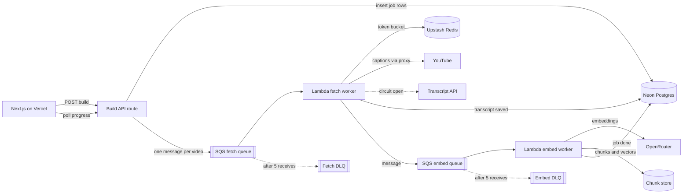

# Transcript Pipeline: Event-Driven Fan-Out on AWS

**Status:** Implementation in progress on `feature/event-driven-transcript-pipeline`. The queue path is behind `KB_PIPELINE` (`legacy` default, `queue` for everyone, `admin` for admin users). Without SQS URLs, workers run in-process so local/dev still works.
**Owner:** Bharath Lakkoju
**One-page summary for reviewers:** [TRANSCRIPT-PIPELINE-ONE-PAGER.md](./TRANSCRIPT-PIPELINE-ONE-PAGER.md)

## Summary

Knowledge-base (KB) builds move from a single chain of self-calling Vercel functions to a queue-based pipeline on AWS. Every video in a build becomes its own job. Jobs flow through two Amazon SQS queues, one for fetching transcripts and one for embedding them, and AWS Lambda workers process each queue independently. Neon Postgres records the state of every job. The Next.js app on Vercel only enqueues work and reads progress.

The goal is faster builds, builds that survive YouTube blocking, fair sharing between users, and failures that are visible and replayable instead of silent.

## Why we are changing

The current build lives in `lib/services/kb-build-job.ts`. It works, but its design caps speed and reliability:

| Today | Effect |
| --- | --- |
| One build lock per KB (`kb-build-lock.ts`) and one video at a time, paced 1.5 to 2 seconds apart (`kb-index-pace.ts`) | A 30-video KB takes minutes, even when YouTube responds instantly |
| Each invocation chains videos for up to 240 seconds, then calls `/kick-build` on itself (`kb-build-continue.ts`) | If a self-call is lost, the build stalls until stale-build recovery notices |
| Retries sleep inside the function, up to 30 seconds per attempt | Paid function time is spent waiting, and one blocked video holds up the rest of the build |
| KB records live in Redis and `updateKnowledgeBase` does an unlocked read, modify, write | Safe only because the lock serializes everything. Running videos in parallel on this store would lose updates |
| A video that keeps failing is skipped, and the reason lives only in the KB record | No dead-letter queue, no alerting, and no way to replay failures after a fix |

## How this helps the product

- **Faster time to first answer.** Videos are indexed in parallel, and chat can start once the first chunks exist. Targets: first queryable chunk in under 20 seconds and a 30-video KB ready in under 60 seconds (p95), when YouTube is reachable.
- **Builds survive YouTube blocking.** A blocked video waits in the queue with backoff instead of failing the build, and a circuit breaker switches to a transcript API when blocking is widespread.
- **Fairness between customers.** Per-user limits stop one 500-video build from delaying everyone else, which matters more as Team and Researcher plans grow.
- **Predictable cost.** Rate limits on YouTube traffic, embeddings and database writes keep spend proportional to useful work. Retries no longer burn function time.
- **Operability.** Each video's state is a database row. Failures land in a dead-letter queue with an alarm and a replay tool.
- **Portfolio value.** This is a production event pipeline with backpressure, retries and a measured analysis of what breaks at 10x, the kind of system Netflix- and Apple-style interviews dig into.

## Target architecture



### Job lifecycle

Each `(kb_id, video_id)` pair is one row in a new `kb_video_jobs` table:

```
queued -> fetching -> fetched -> embedding -> indexed
                  \-> skipped (no_captions, invalid_video)
                  \-> failed  (dead-lettered after 5 receives)
```

Messages carry only IDs (`kbId`, `videoId`, `attempt`), never transcripts, so they stay small. Workers write with upserts keyed on `(kb_id, video_id)`, so a duplicate delivery is harmless. When a job reaches a terminal state, the worker checks in the same transaction whether any jobs for that KB are still open. The last one flips the KB to `ready`, or to `failed` if nothing was indexed. Progress is derived with `COUNT` over job rows instead of a hot counter on the KB row.

### Error classes

These map onto the existing `TranscriptUnavailableError.kind` and `isRetryableLlmError`:

| Class | Source today | Handling |
| --- | --- | --- |
| `no_captions`, `invalid_video` | `kind === "permanent"` | Terminal, job marked `skipped` |
| `blocked`, `rate_limited` | `kind === "transient"` (captcha, 429, "sign in to confirm") | Retry with backoff, counts toward the circuit breaker |
| `provider_5xx`, `provider_429` | `isRetryableLlmError` | Retry with backoff, embed stage lowers its concurrency on 429 |

Speech-to-text stays a build option the user chooses (`transcriptMode: "stt"`). It is not an automatic fallback, because downloading audio from YouTube is blocked in the same way caption fetches are.

## Decisions and alternatives

### Queue: Amazon SQS

| Option | Why not chosen |
| --- | --- |
| **Amazon SQS (chosen)** | Per-message visibility timeouts, a native dead-letter queue with redrive, and Lambda's per-queue maximum concurrency give us job semantics with no cluster to run |
| Apache Kafka (MSK, Confluent) | Built for ordered, replayable streams with many consumers. We need neither ordering nor replay, and retry topics and DLQs would have to be built by hand. Reconsider when analytics or summaries need to replay the transcript stream, or above thousands of messages per second |
| Upstash QStash | Closest runner-up: fewest new vendors and cheapest at low volume. Rejected because it calls public HTTP endpoints, gives less control over concurrency at scale, and is less recognized for the portfolio goal |
| Inngest, Trigger.dev | Excellent developer experience, but a hosted workflow engine hides the queue mechanics this project wants to own and demonstrate |
| Google Cloud Tasks | Rate limits per queue but no per-user fairness, and it adds a second cloud alongside AWS for no gain |

### Compute: AWS Lambda for both stages

Jobs are short: a few seconds with captions, under a minute with speech-to-text. Lambda scales to zero, and the SQS trigger enforces maximum concurrency per queue. Fargate containers cost about $7 per month per idle task and only win when a worker is busy more than about 30% of the day. Containers don't help with YouTube blocking either, because Fargate also uses AWS IP addresses, so the proxy is needed in both cases.

Lambdas run outside a VPC and reach Neon over its public, TLS-protected endpoint through the serverless driver. That avoids a NAT gateway (about $32 per month) and RDS Proxy.

### Job state: Neon Postgres

Parallel workers need atomic, per-video updates and an atomic "last job finished" check. Postgres gives both with row-level upserts and transactions. Redis would need hand-written Lua scripts for the same guarantees, and the KB record would remain a hot key.

### Chunks and vectors: two phases

- **Phase 1 (this branch):** chunks, embeddings and the per-KB vector index stay in Upstash Redis behind the existing `lib/store.ts` and `lib/store/vector-index.ts` APIs. Writes are already per chunk and per video, so they are safe under parallelism once the KB record stops being the shared counter.
- **Phase 2:** move chunks to pgvector (`halfvec`, partitioned by `kb_id`) so Postgres becomes the only system of record. Existing embeddings are copied, not regenerated.

### Rate limiting: Upstash Redis token bucket

YouTube fetches take a token per proxy IP from a shared bucket. A worker that gets no token returns the message with a delay instead of waiting. The free Upstash tier covers this at 10x: about 10 commands per video, or roughly 300,000 commands per month at 30,000 videos.

### Fallback when YouTube blocks: transcript API

When the blocked rate crosses a threshold, a circuit breaker routes fetches to a hosted transcript API for about $0.002 to $0.01 per video. Speech-to-text costs 10 to 50 times more and hits the same blocking.

### Infrastructure as code: AWS CDK in TypeScript

Same language as the app. `NodejsFunction` bundles worker code straight from `lib/`, and the stack lives in the repo under `infra/`, where reviewers can read it.

### Vercel to AWS authentication: OIDC federation

Vercel issues short-lived OIDC tokens that assume an IAM role allowed only to send messages to the fetch queue. No long-lived AWS keys are stored in Vercel.

## Backpressure and retries

- **YouTube egress:** token bucket per proxy IP in Redis.
- **Embedding provider:** tokens-per-minute budget. On a 429 the consumer lowers its concurrency rather than retrying hot.
- **Postgres:** batched inserts and a bounded number of concurrent writers, set through Lambda maximum concurrency.
- **Fairness:** at most 2 active builds and 8 videos in flight per user.
- **Backoff:** retryable failures extend the visibility timeout exponentially with jitter (5s, 20s, 80s, capped at 5 minutes).
- **Dead letters:** after 5 receives a message moves to the DLQ. An alarm fires on DLQ depth, and `scripts/redrive-dlq.ts` replays messages once the cause is fixed.
- **Retry budget:** retries are capped at 20% of fresh traffic per stage.
- **Scaling signal:** age of the oldest message, not queue depth.

## What breaks at 10x

| What breaks | Symptom | Mitigation |
| --- | --- | --- |
| YouTube blocking and rate limits | Block rate climbs, fetch p95 grows, DLQ fills | Global transcript cache first, proxy pool sized to the token bucket, circuit breaker to the transcript API |
| Embedding throughput and cost | 429s, spend scales linearly with videos | Batch 64 to 128 chunks per request, tokens-per-minute budget, per-plan spend caps, reuse chunks across KBs by video |
| Vector storage | A 1536-dimension float4 vector is about 6 KB, so 10M chunks is about 60 GB before the index | Phase 2 pgvector with `halfvec`, partition by `kb_id`, dedicated vector store beyond tens of millions |
| Noisy neighbor | One large build delays every other user | Per-user in-flight caps, a separate queue for large builds |
| Hot progress counter | Lock contention on one KB row | Progress from `COUNT` over job rows, KB row written only on terminal transitions |
| Duplicate delivery and retry storms | Double charges, duplicate chunks | Idempotency keys, upserts, retry budget |

## How we will prove it

The targets above are not measurements yet. Before this ships:

1. **Load test:** `scripts/load-test-pipeline.ts` builds 500 to 1,000 videos across simulated users, with YouTube and OpenRouter stubbed at realistic latency. It records p95 time to first chunk and time to ready.
2. **Failure test:** the same run with 30% of fetches returning "blocked". Expected: the circuit breaker opens, builds still complete, and the DLQ stays under 1% of videos.
3. **Results** are added to the one-pager, replacing at least one reasoned row in the 10x table with a measured one.

## Rollout

1. Feature flag `KB_PIPELINE=legacy|queue`, defaulting to `legacy`.
2. Ship the job table, queues and workers dark, then turn on `queue` for admin users.
3. Run both paths side by side, comparing build time and skip rate.
4. Switch the default, then delete the self-calling chain (`kick-build`, `kb-build-continue.ts`, the build lock and the pacing).

## Cost

At 3,000, 30,000 and 300,000 videos per month, the AWS share (SQS, Lambda, CloudWatch) is about $1 to $3, $3 to $6 and $20 to $30 per month. The residential proxy for YouTube is about 90% of the cost per video at every scale. See [INFRASTRUCTURE.md](./INFRASTRUCTURE.md#aws-transcript-pipeline) for the breakdown.

## Open decisions

- Whether Phase 2 (pgvector) is in scope for this project phase or the next.
- Which transcript API provider to use for the circuit-breaker fallback.
- Whether a residential proxy is already configured in production (`YOUTUBE_HTTP_PROXY`), and with which provider.
